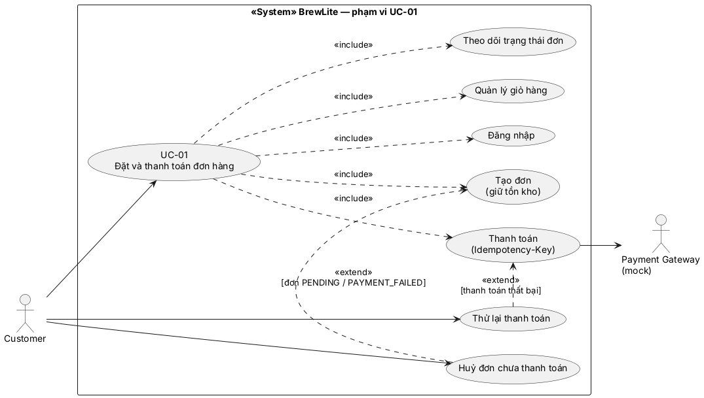

# Đặc tả use-case UC-01 — Đặt và thanh toán đơn hàng

> Task 1.3 · Use-case trọng tâm của BrewLite. Sơ đồ: `docs/diagrams/usecase-uc01-place-and-pay.puml` / `.png`.

## 1. Thông tin chung

| Mục | Nội dung |
|---|---|
| Mã / tên | **UC-01** — Đặt và thanh toán đơn hàng |
| Mục tiêu | Khách hàng chuyển giỏ hàng thành một đơn, thanh toán không tiền mặt và biết đơn đã được ghi nhận để đến quầy nhận đồ uống |
| Actor chính | Khách hàng (đã đăng ký) |
| Actor phụ | Cổng thanh toán (mock) |
| Trigger | Khách bấm **"Đặt đơn"** trong trang giỏ hàng |
| Mức ưu tiên | Must (giá trị nghiệp vụ cốt lõi của MVP) |

## 2. Tiền điều kiện

1. Giỏ hàng có ít nhất 1 dòng hợp lệ (món còn bán, số lượng 1–20).
2. Khách đã đăng nhập; trình duyệt giữ JWT còn hạn. Nếu chưa, hệ thống chuyển sang trang đăng nhập rồi quay lại giỏ hàng (xem luồng thay thế A1).
3. API và cơ sở dữ liệu đang hoạt động (`GET /health` trả 200).

## 3. Hậu điều kiện

| Kết quả | Trạng thái hệ thống |
|---|---|
| **Thành công** | Đơn ở trạng thái `PAID`; có đúng 1 giao dịch `SUCCEEDED`; tồn kho đã trừ; giỏ hàng được xoá; khách thấy màn hình xác nhận (mã đơn, trạng thái) và đơn xuất hiện trong lịch sử |
| **Thanh toán thất bại** | Đơn ở `PAYMENT_FAILED`; tồn kho vẫn đang được giữ; giỏ hàng giữ nguyên; khách có thể thử lại hoặc huỷ |
| **Huỷ / lỗi tạo đơn** | Không có đơn mới (hoặc đơn `CANCELLED`), tồn kho được hoàn lại, không có giao dịch tiền nào |

## 4. Luồng chính (thanh toán thành công)

| Bước | Actor | Hành động |
|---|---|---|
| 1 | Khách | Mở giỏ hàng, kiểm tra các dòng (món, size, topping, số lượng) và tổng tiền, bấm **Đặt đơn** |
| 2 | Hệ thống | Gửi `POST /orders` kèm JWT; xác thực JWT và validate dữ liệu (món, size, topping, số lượng) |
| 3 | Hệ thống | Trong **một transaction**: kiểm tra và trừ tồn kho từng món (optimistic locking), **tính lại đơn giá và tổng tiền từ dữ liệu server** (bỏ qua giá client gửi), lưu đơn ở trạng thái `PENDING` |
| 4 | Hệ thống | Trả về đơn (mã, danh sách món, tổng tiền); giao diện chuyển sang trang thanh toán `/checkout/:id` |
| 5 | Khách | Chọn phương thức (Ví điện tử hoặc Thẻ) và bấm **Thanh toán** |
| 6 | Hệ thống | Giao diện sinh `Idempotency-Key` mới, gửi `POST /payments` (`orderId`, `method`) kèm header này |
| 7 | Hệ thống | API khoá dòng đơn, kiểm tra đơn thuộc về khách và đang ở trạng thái cho phép thanh toán, gọi cổng thanh toán |
| 8 | Cổng thanh toán | Trả về thành công kèm mã giao dịch |
| 9 | Hệ thống | Lưu giao dịch `SUCCEEDED`, chuyển đơn `PENDING → PAID`, **cộng điểm thưởng** (1 điểm cho mỗi 10.000đ thực trả) trong cùng transaction, trả kết quả kèm số điểm vừa nhận |
| 10 | Hệ thống | Giao diện xoá giỏ hàng và hiển thị màn hình xác nhận (mã đơn, trạng thái `PAID`) |
| 11 | Khách | Theo dõi trạng thái đơn (`PAID → PREPARING → READY → COMPLETED`), giao diện làm mới mỗi 5 giây |

## 5. Luồng thay thế

| Mã | Điều kiện | Xử lý |
|---|---|---|
| **A1** | Ở bước 1 khách chưa đăng nhập | Hệ thống chuyển sang `/login?next=/cart`; sau khi đăng nhập quay lại giỏ hàng với giỏ hàng nguyên vẹn, tiếp tục bước 1 |
| **A2** | Ở bước 5 khách rời trang thanh toán mà chưa trả tiền | Đơn vẫn `PENDING`; khách có thể quay lại từ lịch sử đơn để thanh toán, hoặc **huỷ đơn** (đơn `CANCELLED`, tồn kho hoàn lại) |
| **A3** | Ở bước 8 thanh toán thất bại và khách chọn thử lại | Đơn ở `PAYMENT_FAILED` có thể thanh toán lại với `Idempotency-Key` mới; quay lại bước 6 |
| **A4** | Khách bấm **Thanh toán** nhiều lần (double submit) hoặc mạng lỗi khiến client gửi lại cùng yêu cầu | Cùng `Idempotency-Key` → API trả lại đúng kết quả cũ, **không tạo giao dịch thứ hai** |
| **A6** | Giữa bước 4 và 5 khách có từ 100 điểm thưởng và bấm **Dùng điểm** | `POST /orders/:id/points`: trừ điểm (1 điểm = 100đ, tối đa sao cho đơn còn trả ≥ 1.000đ), ghi sổ điểm, tổng tiền giảm tương ứng. Dưới 100 điểm thì nút bị khoá (API trả `422`). Khách có thể **Bỏ dùng điểm** hoặc huỷ đơn để được hoàn điểm; điểm tích sau thanh toán tính trên số tiền thực trả |
| **A5** | Giữa bước 4 và 5 khách nhập mã khuyến mãi | `POST /orders/:id/promotion`: server kiểm tra mã, giữ một lượt dùng, tính lại tổng tiền (tạm tính − giảm giá); khách có thể đổi hoặc gỡ mã (lượt cũ được trả lại). Số tiền thanh toán ở bước 6–9 là tổng đã giảm |

## 6. Luồng ngoại lệ

| Mã | Tình huống | Phản hồi của hệ thống |
|---|---|---|
| **E1** | Hết hàng hoặc không đủ số lượng ở bước 3 | Không tạo đơn, trả `409 Conflict` kèm tên món và số còn lại; khách quay lại giỏ hàng sửa số lượng |
| **E2** | Hai khách cùng đặt món cuối cùng | Chỉ 1 yêu cầu thành công, yêu cầu còn lại nhận `409` (không bán vượt tồn kho) |
| **E3** | Dữ liệu sai (size/topping không hợp lệ cho món, số lượng ngoài 1–20, đơn rỗng) | `400 Bad Request` với thông điệp rõ ràng, không tạo đơn |
| **E4** | JWT thiếu, sai hoặc hết hạn | `401 Unauthorized`; giao diện đăng xuất và chuyển tới trang đăng nhập |
| **E5** | Cổng thanh toán từ chối | Giao dịch `FAILED`, đơn → `PAYMENT_FAILED`, hiển thị lý do, giữ giỏ hàng (xem A3) |
| **E6** | Thiếu hoặc sai `Idempotency-Key` | `400 Bad Request`, không gọi cổng thanh toán |
| **E7** | Dùng lại `Idempotency-Key` cho đơn khác | `422 Unprocessable Entity` |
| **E8** | Thanh toán đơn đã `PAID`/đã huỷ | `409 Conflict`, không trừ tiền lần nữa |
| **E9** | Thanh toán hoặc xem đơn của người khác | `404 Not Found` (không tiết lộ đơn tồn tại) |
| **E11** | Mã khuyến mãi không tồn tại, bị tắt, hết hạn, hết lượt hoặc đơn chưa đạt mức tối thiểu | `422 Unprocessable Entity` kèm lý do; đơn/tổng tiền không đổi (khi nhập lúc tạo đơn thì không tạo đơn và không giữ tồn kho) |
| **E10** | API hoặc cơ sở dữ liệu lỗi | Giao diện báo lỗi và cho phép thử lại; không có giao dịch tiền nào bị trừ khi chưa nhận kết quả |

## 7. Hệ thống làm gì và không làm gì

**Làm:** tính giá và tiền giảm từ server, giữ tồn kho và lượt dùng mã trong transaction, thanh toán mock với idempotency, cộng điểm thưởng sau khi `PAID`, quản lý trạng thái đơn bằng state machine, lưu lịch sử đơn.

**Không làm (trong UC-01):** thanh toán bằng tiền mặt, tích hợp cổng thanh toán thật, hoàn tiền sau khi đã `PAID`, thông báo đẩy.

## 8. Liên kết yêu cầu và kiểm thử

| Yêu cầu | Nội dung | Luồng liên quan | Kiểm thử |
|---|---|---|---|
| FR-03, FR-06 | Giá theo size/topping, tổng tiền giỏ | Bước 1, 3 | Unit `pricing.spec.ts`, `cart.test.ts`; INT-T02 |
| FR-04, FR-05 | Thêm / sửa / xoá dòng trong giỏ | Bước 1 | `cart.test.ts`, `ProductDetail.test.tsx` |
| FR-08, FR-09, NFR-05 | Đăng nhập, bắt buộc JWT để tạo đơn | A1, E4 | INT-T01 |
| FR-10, NFR-03 | Tạo đơn `PENDING`, validate dữ liệu | Bước 2–4, E3 | INT-T02, INT-T03 |
| FR-17 | Kiểm soát tồn kho đồng thời | Bước 3, E1, E2 | INT-T04, INT-T05 |
| FR-11 | Thanh toán không tiền mặt (mock) | Bước 5–9 | INT-T06, INT-T08 |
| FR-12 | Xử lý thanh toán thất bại và thử lại | A3, E5 | INT-T08 |
| FR-13 | Idempotency khi gửi lại thanh toán | A4, E6, E7 | INT-T06, INT-T09 |
| FR-14 | Màn hình xác nhận đơn | Bước 10 | `checkout.test.tsx` |
| FR-15 | Lịch sử đơn, không lộ đơn người khác | E9 | INT-T10 |
| FR-16 | State machine trạng thái đơn | Bước 9, 11, E8 | `order-status.spec.ts`, INT-T07, INT-T12 |
| (huỷ đơn) | Huỷ đơn chưa thanh toán, hoàn kho và trả lượt dùng mã | A2 | INT-T11, INT-T22 |
| FR-18 | Mã khuyến mãi và điểm thưởng | A5, E11, bước 9 | INT-T18 → T24; `promotion.spec.ts`, `loyalty.spec.ts`; `checkout.test.tsx`; E2E-T07, E2E-T08 |
| FR-25 | Đổi điểm thưởng thành giảm giá | A6 | INT-T26 → T28; `loyalty.spec.ts`; `checkout.test.tsx` (đổi điểm) |

## 9. Tiêu chí chấp nhận (dùng để viết test)

- **AC-1:** Với giỏ hợp lệ và JWT hợp lệ, `POST /orders` trả `201`, đơn `PENDING`, `total` bằng tổng (đơn giá tính ở server × số lượng) — không phụ thuộc giá client gửi.
- **AC-2:** Gọi `POST /orders` không có JWT trả `401`; payload sai trả `400`.
- **AC-3:** Khi tồn kho không đủ, trả `409` và tồn kho không bị âm; với 2 yêu cầu đồng thời cho 1 sản phẩm cuối cùng chỉ 1 yêu cầu thành công.
- **AC-4:** `POST /payments` thành công đưa đơn sang `PAID` và tạo đúng 1 giao dịch `SUCCEEDED`.
- **AC-5:** Gửi lại `POST /payments` với cùng `Idempotency-Key` luôn trả cùng kết quả và không tạo giao dịch mới.
- **AC-6:** Khi cổng thanh toán từ chối, đơn sang `PAYMENT_FAILED` và vẫn thanh toán lại được; thanh toán đơn đã `PAID` trả `409`.
- **AC-7:** Khách chỉ truy cập được đơn của chính mình (người khác nhận `404`).
- **AC-9:** Mã hợp lệ làm tổng tiền giảm đúng `computeDiscount` (server tính, bỏ qua số client gửi); mã không hợp lệ trả `422`; mã chỉ còn 1 lượt, 2 khách đặt cùng lúc → đúng 1 đơn được giảm; huỷ đơn trả lại lượt.
- **AC-10:** Thanh toán thành công cộng `floor(tổng thực trả / 10.000)` điểm đúng một lần (gửi lại cùng `Idempotency-Key` không cộng thêm); thanh toán thất bại không cộng điểm.
- **AC-11:** Dưới 100 điểm, `POST /orders/:id/points` trả `422` và số dư không đổi; từ 100 điểm, đổi trừ đúng số điểm và giảm 100đ mỗi điểm, đơn vẫn trả tối thiểu 1.000đ; bỏ dùng hoặc huỷ đơn hoàn lại đủ điểm; hai đơn dùng điểm đồng thời không làm số dư âm.
- **AC-8 (UI):** Sau thanh toán thành công, giỏ hàng trống và màn hình xác nhận hiển thị đúng mã đơn và trạng thái.
